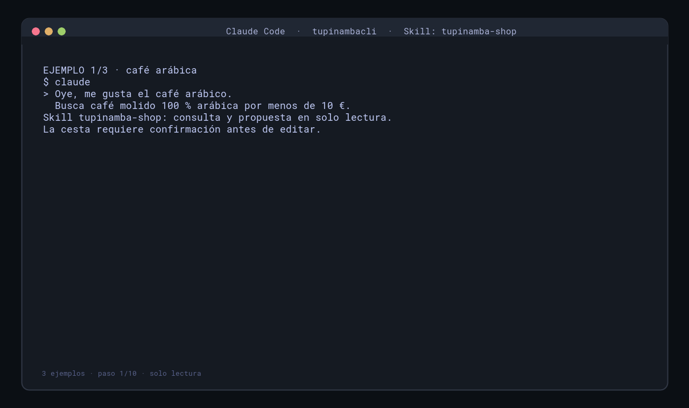

<p align="center">
  
</p>

<h1 align="center">tupinambacli</h1>

<p align="center">
  <strong>Client de catàleg, recomanació i cistella per a Càpsules Tupinamba</strong>
</p>

<p align="center">
  <a href="https://github.com/seifreed/tupinambacli/releases/tag/v0.1.0"></a>
  <a href="https://github.com/seifreed/tupinambacli/blob/main/go.mod"></a>
  <a href="https://github.com/seifreed/tupinambacli/blob/main/LICENSE"></a>
  <a href="https://github.com/seifreed/tupinambacli/actions/workflows/ci.yml"></a>
  <a href="https://github.com/seifreed/tupinambacli/actions/workflows/ci.yml"></a>
</p>

<p align="center">
  <a href="https://github.com/seifreed/tupinambacli"></a>
  <a href="https://github.com/seifreed/tupinambacli/issues"></a>
  <a href="https://buymeacoffee.com/seifreed"></a>
</p>

---

## Visió general

**tupinambacli** és un client no oficial en Go per consultar el catàleg de
[Càpsules Tupinamba](https://capsulastupinamba.com/), comparar productes,
calcular propostes de compra i preparar una cistella que l'usuari finalitza al
navegador.

El projecte combina:

- el binari `tupinamba`, que consulta la botiga i opera sobre una cistella;
- la SKILL `tupinamba-shop`, que ensenya a un agent com convertir peticions en
  llenguatge natural en recomanacions i operacions segures.

El projecte no fa pagaments, no reserva estoc i no confirma comandes.

<p align="center">
  
</p>
<p align="center"><sub>Simulació de tres exemples amb sortides reals del CLI; la cistella no es modifica sense confirmació.</sub></p>

### Característiques principals

| Característica | Descripció |
|----------------|------------|
| **Catàleg en viu** | Cerca, col·leccions, fitxes, variants, SKU, preus i disponibilitat |
| **Referències flexibles** | Resolució per `handle`, identificador de producte, variant o SKU |
| **Processament en bloc** | Resolució de llistes i càlcul de múltiples línies |
| **Pressupostos segurs** | Límits per línia i comprovació del subtotal complet |
| **Cistella Shopify** | Lectura, addició, quantitat absoluta, eliminació i buidatge |
| **Traspàs al navegador** | URL específica per carregar la cistella visible |
| **Recomanació amb agents** | Qualitat, gust, quantitats, ocasions, substitucions i restriccions |
| **Claude Desktop** | Eines MCP locals per cercar, calcular i preparar canvis confirmats a la cistella |
| **Dades estructurades** | Sortida de text, JSON i TOON |
| **Auditoria integrada** | Format, `go vet`, tests, build, govulncheck i gosec |

### Sortides compatibles

```text
Catàleg       Text, JSON, TOON
Productes     Fitxa, variants, SKU, preu i disponibilitat
Propostes     Línies, quantitats, subtotal i límit màxim
Cistella      Estat, recompte, subtotal i URL específiques
Automatització stdout estructurat + codis de sortida
```

---

## Instal·lació

### Des de GitHub Releases (recomanat)

Descarrega el binari corresponent al sistema des de
[Releases](https://github.com/seifreed/tupinambacli/releases).

Hi ha binaris per a:

- macOS, Intel i Apple Silicon;
- Linux, `amd64` i `arm64`;
- Windows, `amd64`.

En sistemes Unix, dona permís d'execució al fitxer descarregat:

```bash
chmod +x tupinamba-*
```

### Amb Go

```bash
go install github.com/seifreed/tupinambacli/cmd/tupinamba@latest
```

### Des del codi font

```bash
git clone https://github.com/seifreed/tupinambacli.git
cd tupinambacli
go build -o tupinamba ./cmd/tupinamba
./tupinamba version
```

### Instal·lació de la SKILL

Per a Claude Code:

```bash
./scripts/install-skill.sh
```

Per a Codex:

```bash
CLAUDE_SKILLS_DIR="$HOME/.codex/skills" ./scripts/install-skill.sh
```

## MCP per a Claude Code i Codex

El CLI ja pot arrencar el servidor MCP. Només cal compilar-lo una vegada i
registrar la mateixa comanda al client que facis servir:

```bash
go build -o ./tupinamba ./cmd/tupinamba

# Claude Code
claude mcp add --scope user tupinamba -- "$(pwd)/tupinamba" mcp

# O bé Codex
codex mcp add tupinamba -- "$(pwd)/tupinamba" mcp
```

Reinicia el client. `claude mcp list` o `codex mcp list` confirma que s'ha
registrat. El servidor reutilitza `~/.tupinamba`; per tant, no cal iniciar
sessió per cercar. Si vols operar sobre la cistella que ja tens al navegador,
importa la sessió amb el CLI abans. Sense aquesta sessió, el servidor treballa
amb una cistella nova.

El servidor parla per `stdio`, reserva `stdout` per al protocol i escriu els
logs a `stderr`. Exposa cerques, fitxes de producte, estat de cistella, càlculs
i canvis de cistella amb confirmació. Perquè l'agent també segueixi les
instruccions de compra del projecte, instal·la la SKILL amb
`./scripts/install-skill.sh` (Claude Code) o
`CLAUDE_SKILLS_DIR="$HOME/.codex/skills" ./scripts/install-skill.sh` (Codex).

Per Claude Desktop, continua disponible l'extensió local: construeix-la amb
`./scripts/build-claude-desktop.sh` i instal·la el `.mcpb` des de Configuració →
Extensions → Configuració avançada.

---

## Inici ràpid

```bash
# Cercar i consultar productes
./tupinamba search intense --limit 5
./tupinamba product pack-discovery

# Navegar per les càpsules compostables
./tupinamba categories --id capsulas-compostables --limit 50

# Calcular una proposta sense modificar la cistella
printf 'adigio-compostable 2\npack-discovery 1\n' \
  | ./tupinamba total -f - --max 40 --json

# Comprovar la sessió i la cistella
./tupinamba whoami
./tupinamba checkout status --json
```

---

## Ús

### Interfície de línia d'ordres

```bash
# Cerca amb sortida estructurada
./tupinamba search intenso --limit 10 --json

# Fitxa resolta pel handle
./tupinamba product adigio-compostable --json

# Resolució d'una llista
./tupinamba batch -f productes.txt --toon

# Total amb límit estricte
./tupinamba total -f compra.txt --max 30 --json

# Estat complet de la cistella
./tupinamba checkout status --max 30 --json
```

### Comandaments disponibles

| Comandament | Descripció |
|-------------|------------|
| `search <terme>` | Cerca al títol, la descripció, el tipus i les etiquetes |
| `product <referència>` | Mostra la fitxa i les variants del producte |
| `batch -f <fitxer\|->` | Resol un terme de cerca per línia |
| `total -f <fitxer\|->` | Suma línies `<referència> [quantitat]` |
| `collections` | Llista les col·leccions de la botiga |
| `categories --id <handle>` | Llista els productes d'una col·lecció |
| `login --from-browser chrome` | Importa una sessió de Chrome a macOS |
| `import-har --file <fitxer>` | Importa una capçalera Cookie des d'un HAR |
| `set-cookie --stdin` | Desa una Cookie sense exposar-la a l'historial |
| `whoami` | Comprova que la sessió pot llegir la cistella |
| `cart get` | Llegeix la cistella |
| `cart add <referència> <quantitat>` | Afegeix unitats de forma acumulativa |
| `cart set <referència> <quantitat>` | Fixa la quantitat absoluta; `0` elimina |
| `cart clear` | Buida la cistella |
| `checkout status` | Mostra subtotal, estat i URL de cistella i checkout |

### Opcions principals

| Opció | Descripció |
|-------|------------|
| `--limit N` | Limita els resultats de cerca o col·lecció |
| `--variant <sku\|id>` | Selecciona una variant no predeterminada |
| `--max EUR` | Rebutja una línia o cistella que superi el límit |
| `--json` | Emet JSON |
| `--toon` | Emet TOON |
| `-f <fitxer\|->` | Llegeix un fitxer o l'entrada estàndard |

Els codis de sortida són `0` per èxit, `1` per error d'execució i `2` per ús
incorrecte. Les dades s'escriuen a `stdout` i els errors a `stderr`.

### Referències i variants

Els comandaments de producte i cistella accepten un `handle`, un identificador
de producte, un identificador de variant o un SKU. El `handle` és la referència
recomanada per a la comprovació final.

```bash
./tupinamba cart set pack-discovery 1 --variant E2001 --max 30
```

### Fitxers d'entrada

`batch` espera un terme per línia:

```text
adigio
intense
pack discovery
```

`total` accepta una referència i una quantitat opcional:

```text
adigio-compostable 2
pack-discovery 1
```

---

## SKILL per a agents

La SKILL converteix peticions com aquestes en consultes, comparacions i plans:

- «Recomana'm les càpsules de més qualitat»;
- «Vull 20 cafès intensos per menys de 15 €»;
- «Compara dues opcions suaus i una amb més cos»;
- «Prepara una selecció variada per regalar»;
- «Calcula cafè per a una oficina durant un mes»;
- «Afegeix aquesta llista a la cistella»;
- «Reposa l'última proposta»;
- «Completa la cistella fins a 30 €, sense superar-los».

### Capacitats de recomanació

L'agent pot:

- descobrir i comparar candidats disponibles;
- distingir capses, packs, càpsules, varietats i racions;
- calcular el preu per càpsula quan el format està documentat;
- estimar la durada segons el consum i les racions publicades;
- adaptar-se a ús diari, tast, oficina, regal o reposició;
- respectar pressupostos, exclusions, formats i composicions;
- proposar substitucions justificades si falta un producte;
- processar una llista enganxada;
- transcriure una fotografia i demanar que se'n validin les línies;
- preparar i verificar una cistella després d'una confirmació explícita.

### Selecció basada en qualitat

Quan es demana el producte «millor» o «més premium», l'agent compara les fitxes
vigents segons:

1. composició i origen indicat;
2. notes de tast, cos, crema, acidesa i equilibri;
3. torrat i preparació;
4. posicionament de qualitat explícit.

El preu, el format, la disponibilitat i la sostenibilitat s'informen, però no
es converteixen automàticament en una puntuació de qualitat. Si les evidències
no separen dos candidats, l'agent presenta un empat.

Les característiques de sabor, la cafeïna, els ingredients, els al·lèrgens,
l'origen i les certificacions només s'afirmen quan consten a la fitxa.

### Quantitats i intenció

- una càpsula o ració equival a una beguda;
- una capsa conté les unitats indicades a la fitxa;
- un pack és una unitat comercial amb el contingut descrit;
- una varietat és un perfil diferent, no una quantitat.

«20 cafès» significa 20 racions, no 20 capses.

| Petició | Acció |
|---------|-------|
| «recomana», «compara» o «prepara» | Proposta de només lectura |
| «afegeix» | Increment amb `cart add`, després de confirmar |
| «posa» o «deixa'n X» | Quantitat absoluta amb `cart set` |
| «substitueix la cistella» | Comparació, confirmació, buidatge i càrrega |
| «completa fins a X» | Addicions útils sense gastar arbitràriament el marge |
| «reposa l'anterior» | Revalidació de l'última proposta de la conversa |

---

## Flux segur de cistella

Abans de qualsevol escriptura, l'agent:

1. consulta la cistella existent;
2. resol els productes finals pel seu `handle`;
3. comprova format, variant, preu i disponibilitat;
4. fixa destinació, quantitats i límit màxim;
5. mostra el canvi exacte, els SKU i els subtotals;
6. espera una confirmació explícita;
7. modifica la cistella una sola vegada;
8. verifica el total amb `checkout status --max`;
9. obre `browser_cart_url` perquè el resultat sigui visible.

```bash
./tupinamba whoami
./tupinamba cart set adigio-compostable 2 --max 10
./tupinamba cart set pack-discovery 1 --max 30
./tupinamba checkout status --max 40 --json
```

`cart set` és idempotent. `cart add` és acumulatiu i no es repeteix
automàticament després d'un error incert.

El `--max` de `cart add` i `cart set` protegeix només aquella línia; en `cart add`
també compta les unitats d'aquesta variant que ja hi ha a la cistella.
`checkout status --max` comprova el subtotal complet.

### Cistella i navegador

El CLI i el navegador poden tenir cookies diferents. La importació amb
`login --from-browser chrome` és unidireccional: el CLI pot llegir la sessió,
però no pot escriure una cookie nova directament a Chrome.

`checkout status --json` retorna:

- `checkout_url`, per continuar la compra amb les línies resoltes;
- `browser_cart_url`, per carregar-les a la cistella visible del navegador.

Cal obrir `browser_cart_url`; una URL genèrica de checkout no garanteix que el
navegador comparteixi la cistella del CLI.

---

## Dades en viu i memòria cau

- `collections` i `categories` consulten la botiga directament;
- `product <handle>` intenta primer la fitxa directa;
- si la consulta falla, `product` pot recórrer al catàleg local;
- `search` i les referències per SKU o identificador poden usar
  `~/.tupinamba/catalog.json`, amb una vigència màxima de 10 minuts;
- `total` torna a resoldre les referències i rebutja quantitats no positives o
  productes no disponibles.

La disponibilitat és una comprovació de millor esforç, no una reserva. Si la
col·lecció i la fitxa discrepen, es prioritza la fitxa final consultada pel seu
`handle`.

---

## Enviament i checkout

Els imports del CLI són subtotals de producte. Les despeses d'enviament,
l'adreça, el pagament i l'estoc final es confirmen al navegador.

`can_checkout: true` només significa que la cistella no és buida. No valida el
pagament, l'adreça, l'enviament ni la comanda.

La política d'enviament pot canviar i s'ha de consultar abans de citar imports,
llindars o terminis.

---

## Seguretat i privacitat

- no es mostren cookies, tokens de cistella ni dades de sessió;
- `set-cookie --stdin` evita exposar una cookie a l'historial;
- la sortida de les comandes `cart` elimina el token de la cistella;
- cap recomanació autoritza una modificació;
- no es buida, duplica o substitueix una cistella sense confirmació;
- no es desa historial de compra ni preferències permanents;
- no s'infereixen afirmacions mèdiques o dietètiques.

La sessió es desa a `~/.tupinamba/session.json`.

### Variables d'entorn

| Variable | Descripció |
|----------|------------|
| `TUPINAMBA_CONFIG_DIR` | Canvia el directori de configuració, sessió i memòria cau |
| `TUPINAMBA_MAX_EUR` | Defineix el límit predeterminat de despesa |

---

## CI i auditoria

Cada push a `main` i cada pull request executen `golangci-lint` v2.15.0 i `make clean-audit`:

```text
Format       gofmt
Lint         golangci-lint (errcheck, govet, ineffassign, staticcheck, unused)
Anàlisi      go vet + staticcheck
Tests        go test ./...
Compilació   go build
Vulnerabilitat govulncheck
Seguretat    gosec
Arquitectura límit de 220 línies per fitxer Go
```

Comprovació local completa:

```bash
make lint
make clean-audit
```

`make lint` requereix `golangci-lint` 2.15.0 a `PATH`; CI instal·la aquesta
versió mitjançant l'acció oficial dels seus autors.

Prova real de l'API de cistella. Crea una configuració temporal i aïllada;
no llegeix ni modifica la sessió o la cistella habitual:

```bash
./scripts/cart-smoke.sh E102800
```

Les etiquetes `v*` publiquen binaris per a macOS, Linux i Windows:

```bash
git tag v0.1.0
git push origin v0.1.0
```

---

## Requisits

- Go 1.26 o superior per compilar;
- connexió a internet per consultar la botiga;
- Chrome a macOS només si es vol importar una sessió del navegador;
- consulta de catàleg disponible sense iniciar sessió.

---

## Contribucions

Les contribucions són benvingudes.

1. Fes un fork del repositori.
2. Crea una branca: `git checkout -b feature/nova-funcio`.
3. Implementa el canvi i executa `make clean-audit`.
4. Fes commit: `git commit -m 'feat: afegeix nova funció'`.
5. Puja la branca i obre una pull request.

---

## Suport al projecte

Si el projecte et resulta útil, pots donar suport al desenvolupament:

<a href="https://buymeacoffee.com/seifreed" target="_blank">
  
</a>

---

## Llicència

Aquest projecte es distribueix sota la llicència MIT. Consulta
[LICENSE](LICENSE).

**Atribució**

- Autor: **Marc Rivero López** | [@seifreed](https://github.com/seifreed)
- Repositori: [github.com/seifreed/tupinambacli](https://github.com/seifreed/tupinambacli)

---

<p align="center">
  <sub>Creat per convertir peticions de cafè en decisions verificables i cistelles segures</sub>
</p>
